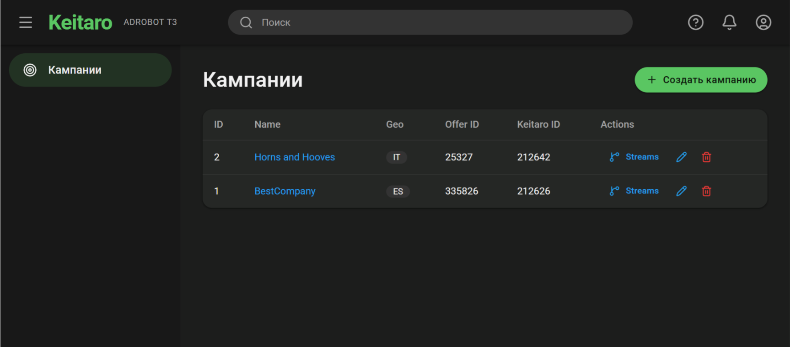
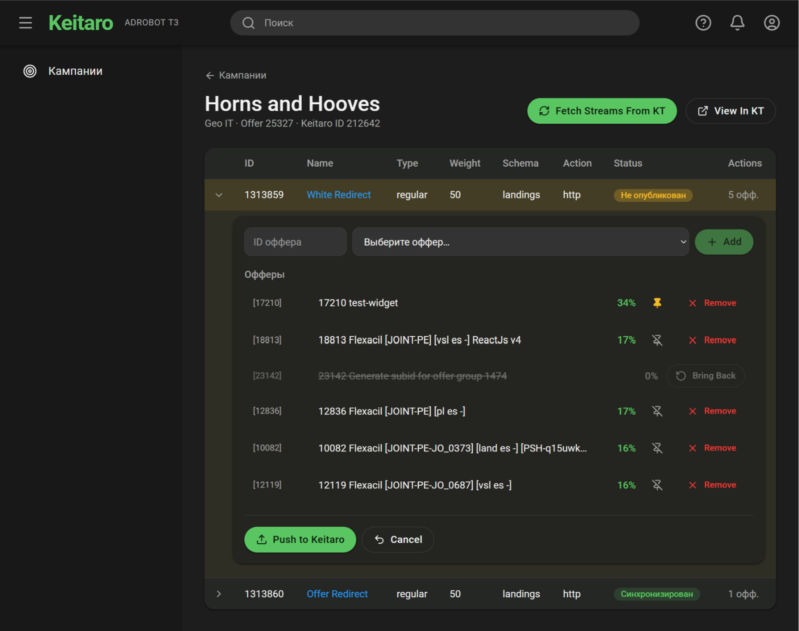
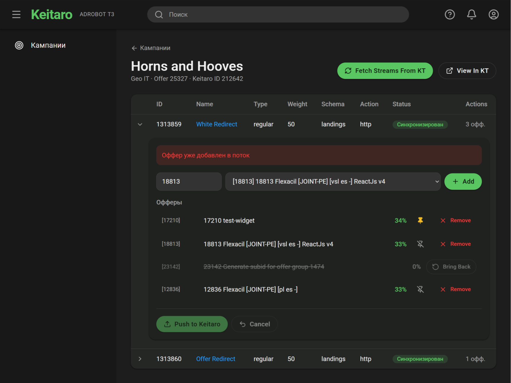

# Adrobot T3 — управление кампаниями Keitaro

Fullstack-приложение: FastAPI проксирует [Keitaro Admin API](https://admin-api.docs.keitaro.io), клиент в папке `client` создаёт и редактирует кампании с двумя потоками (White и Offer), управляет офферами в потоках.

## Запуск backend

Нужны Python 3.11+ и заполненный файл окружения.

```sh
cd backend
python -m venv .venv
# Windows: .venv\Scripts\activate
# macOS/Linux: source .venv/bin/activate
pip install -r requirements.txt
copy .env.example .env   # Windows
# cp .env.example .env   # macOS/Linux
```

Отредактируйте `backend/.env` (URL трекера и API-ключ). Затем:

```sh
uvicorn main:app --reload
```

API слушает `http://localhost:8000`. Документация OpenAPI: `http://localhost:8000/docs`.

## Запуск client

Нужны Node.js 20+ и npm.

```sh
cd client
npm install
npm run dev
```

Клиент по умолчанию ходит в `http://localhost:8000`. Другой адрес бэкенда задаётся переменной `VITE_API_URL`.

## Создание API-ключа Keitaro

В админке трекера: **Профиль -> API ключи -> Создать новый ключ**. Подставьте значение в `KEITARO_API_KEY`. URL трекера (без суффикса `/admin_api/v1`).

## Переменные окружения

| Переменная | Где | Описание | Пример |
|---|---|---|---|
| `KEITARO_API_URL` | `backend/.env` | Базовый URL трекера | `https://tracker.example.com` |
| `KEITARO_ADMIN_URL` | `backend/.env` | Корень админки для View In KT. Ссылка: `{admin}/#!/campaign/{keitaro_id}/main`. Если пусто — `{KEITARO_API_URL}/admin` | `https://tracker.example.com/admin` |
| `KEITARO_API_KEY` | `backend/.env` | Ключ Admin API | `029e67361fc20e99ad02a8` |
| `KEITARO_DOMAIN_ID` | `backend/.env` | ID домена кампании (необязательно) | `1` |
| `KEITARO_GROUP_ID` | `backend/.env` | ID группы кампании (необязательно) | `1` |
| `KEITARO_SOURCE_ID` | `backend/.env` | ID источника трафика (необязательно) | `1` |
| `VITE_API_URL` | окружение client | Адрес FastAPI для браузера | `http://localhost:8000` |

Пример окружения: [backend/.env.example](backend/.env.example).

## Примечание

Миграции не требуются. Используется SQLite, таблицы создаются через `create_all` при старте приложения; для новых колонок выполняется лёгкий `ALTER TABLE`. Файл базы: `backend/campaigns.db`.

## Docker и Makefile

```sh
cp backend/.env.example backend/.env   # заполните ключ
make up        # docker compose up --build
make down
make test      # pytest + vitest (client)
make backend   # uvicorn с reload
make client    # bun/npm run dev в client (Docker: http://localhost:5173)
```

## Демо

Список кампаний: создание, поиск, переход к потокам.



Поток кампании: офферы, веса, публикация в Keitaro.



Ошибка, если оффер уже есть в потоке.

